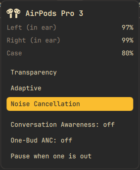
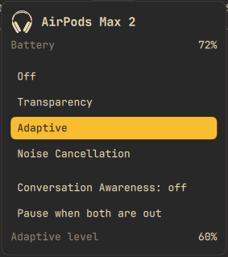
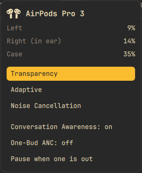

# hypora-pods

AirPods support for Hypora Linux (Hyprland + Quickshell), written in Rust.

It shows battery for each pod and the case, lets you switch listening modes, and
pauses media when you take a pod out. A small daemon talks to the AirPods; a
Quickshell widget in the bar shows the result.

## What it does

- **Battery** for the left pod, the right pod and the case, with charging and in-ear state.
  Headphones such as the AirPods Max show one battery and no case.
- **Listening modes**: Off, Transparency, Adaptive, Noise Cancellation. The panel shows
  only the modes your model has (AirPods Pro 3 has no Off).
- **Conversation Awareness**, **One-Bud ANC**, and the adaptive noise level, on the models that support them.
- **Ear detection**: pause when one pod is out, when both are out, or never.
- **Case lid** state and battery while the pods are in the case.
- **Low-battery notifications** at 10%.
- **Playback profile**: leaves the codec to PipeWire (AAC for AirPods) and only steps in if the card came up with no playback profile.
- Makes the AirPods the default output when they connect, and moves what is playing onto them.
- Reconnects after suspend.

## Screenshots

The bar item shows the icon for your model and the lowest battery. It turns red below 15%.


Click it for the panel. AirPods Pro 3, in both ears, with Noise Cancellation on:



Headphones such as the AirPods Max show one battery, no case, and the adaptive level
when Adaptive is on:



With a pod low and out of the ear, the case charging, and Transparency on:



These show fake devices, made with a hand-written status file.

Nothing is polled. The daemon writes a status file when something changes, and the widget watches it.

## Install

### On Hypora Linux

You need Rust to build the daemon, and the install step runs as you (no root):

```sh
sudo dnf install cargo
git clone <this repo>
hypora-plugin install ./librepods-hypora
```

(`hypora-install-plugin`, run from inside the clone, does the same.)

`hypora-plugin` shows every file it will write and every script it will run, with checksums
(`scripts/install.sh` builds the daemon with cargo and starts a user service), then asks. The bar item
appears on its own once your AirPods connect. Remove it with `hypora-plugin remove hypora-pods`, and
update it with `hypora-plugin update hypora-pods` (it shows the summary and asks again).
See Hypora's `docs/plugins.md`.

The build uses `cargo build --locked`, so only the dependency versions pinned in `Cargo.lock` are used.

### On any other Quickshell setup

You need Rust (`cargo`), BlueZ, PipeWire or PulseAudio (`pactl`), and Quickshell. The widget file edits assume a Hypora-style `Bar.qml` with a `Tray {` line.

```sh
git clone <this repo> && cd librepods-hypora
scripts/install.sh
```

This builds the daemon, installs `hypora-pods` and `hypora-pods-ctl` into `~/.local/bin`,
enables the `hypora-pods` user service, and adds the widget to
`~/.config/quickshell` (a marked line in `Bar.qml`, plus four QML files; the original
is kept as `Bar.qml.hypora-pods.bak`).

Options (environment variables): `PREFIX` (default `~/.local`), `SKIP_WIDGET=1` to skip the
widget, `WIDGET_DIR` for a Quickshell config somewhere else.

Pair your AirPods the usual way (`bluetoothctl`), then connect them. Check with:

```sh
hypora-pods-ctl status
```

The first time the pods connect, the daemon asks them for the keys it needs to recognise
their Bluetooth advertisements. It stores them in `~/.config/hypora-pods/keys.json`
(owner only). Lid state and battery while the pods are in the case work after that.

## Remove

```sh
scripts/uninstall.sh
```

This removes the widget, the service, the binaries, and the stored keys and status file.

## Using it

- Click the AirPods icon and battery in the bar for the panel. The bar item is hidden until pods are connected.
- From a terminal:

| Command | Effect |
|---|---|
| `hypora-pods-ctl status` | readable summary of battery, mode and settings (`--json` for the raw status) |
| `hypora-pods-ctl noise:off` / `anc` / `transparency` / `adaptive` | listening mode |
| `hypora-pods-ctl adaptive:N` | adaptive noise level, 0 to 100 |
| `hypora-pods-ctl ca:on` / `ca:off` | Conversation Awareness |
| `hypora-pods-ctl onebud:on` / `onebud:off` | One-Bud ANC |
| `hypora-pods-ctl ear:one` / `ear:both` / `ear:off` | when to pause media |

A command the connected model does not support is refused with a message.

### Tap controls

The AirPods send every stem press to Linux as a separate play key and never turn two or three presses
into skip or previous. With the udev rule below installed, the daemon counts the taps itself:
**1 tap play/pause, 2 taps next, 3 taps previous**. It takes the pods' key device exclusively, so
your Hyprland media-key bindings are not involved and still work for your keyboard.

The rule lets you, as the logged-in user, read the AirPods' key device and nothing else. The install
script puts it in place for you: it says what it is about to do and then runs `sudo`, so you will be asked
for your password once. Without a terminal it prints the command instead. To do it by hand:

```sh
sudo install -m644 udev/70-hypora-pods.rules /etc/udev/rules.d/
sudo udevadm control --reload && sudo udevadm trigger --subsystem-match=input
```

If taps still do nothing, reconnect the AirPods. Without the rule the daemon says so in its log and the pods behave as before.

To work on the widget without AirPods, run a fake device:

```sh
hypora-pods --stub A3064     # an AirPods Pro 3; try A3454 for a Max 2
```

## How it works

```
AirPods <-- L2CAP (AAP) --> hypora-pods <-- Unix socket --> hypora-pods-ctl
   |  BLE adverts (case)        |  writes
   +--- BlueZ (D-Bus) ----------+--> ~/.local/state/hypora-pods/status.json --> Quickshell widget
```

| Crate | Role |
|---|---|
| `aap-protocol` | packets, parsers, model table, the `status.json` schema, the verb format. No I/O. |
| `ble-adv` | BLE advertisement parsing, address resolution, decryption. No I/O. |
| `hypora-pods` | the daemon: BlueZ, the L2CAP link, BLE scan, media, notifications, audio profile |
| `hypora-pods-ctl` | sends verbs, installs the widget |

The widget lives in `quickshell/` and is embedded into `hypora-pods-ctl`.

## Development

```sh
cargo test --workspace
```


## Security and privacy

- The daemon runs as your user, not root, under a locked-down systemd unit (no capabilities,
  read-only home, a syscall filter, only Unix and Bluetooth sockets).
- It never uses the network. The control socket (`$XDG_RUNTIME_DIR/hypora-pods.sock`), the status file
  and the pairing keys are readable only by you.
- Everything it reads from the AirPods or from Bluetooth advertisements is treated as untrusted:
  parsers check lengths, and tests feed them random bytes. Device names are shown as plain text.
- The control socket only accepts the fixed verbs listed above.
- Tap controls read one input device, the Apple Bluetooth media-key device, through a user-only ACL. The unit allows
  character input devices read-only and keeps every other device closed.

## Credits and licence

The protocol work (Apple's AAP over L2CAP and the BLE advertisement format) comes from
[LibrePods](https://github.com/kavishdevar/librepods) by Kavish Devar, GPL-3.0. This project
reimplements it in Rust for Hypora. Licensed GPL-3.0-or-later; see `LICENSE`.

## Status

Built phase by phase. The protocol, status file, widget install, and decision logic are covered by
tests. Talking to real AirPods, BLE scanning, media control and audio-profile switching depend on
hardware and have had little real-world testing, so expect rough edges and please report them.
The control channel number (L2CAP PSM `0x1001`) is assumed, not verified.
